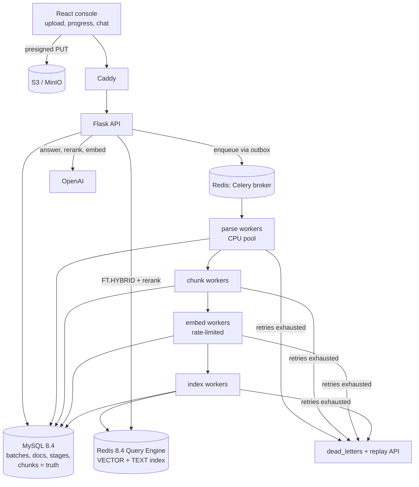

# PageCite: System Design

## 1. Problem

Organisations hold large piles of PDF and DOCX files (policies, circulars, manuals) and need accurate, **cited** answers from them. A naive RAG demo has four problems:

- It parses inside the HTTP request, so large uploads time out.
- It loses work when a worker crashes.
- It retrieves badly on exact terms, because vector-only search misses circular numbers, section IDs and names.
- No one can tell whether answers are actually correct.

PageCite fixes these with:

- direct uploads to S3
- durable staged workers that retry and can be replayed
- hybrid retrieval with citations
- an evaluation harness

**Non-goals for the MVP:**

- arbitrary file types
- custom model training
- multi-region deployment
- the Phase B supersession/versioning work

## 2. Requirements

| Type | Requirement |
|---|---|
| Functional | Batch upload (presigned S3 URLs), per-file progress, retry and cancel, delete a document |
| Functional | Pipeline: parse (PDF/DOCX, OCR only for scanned pages) → chunk → embed → index |
| Functional | Ask a question → streamed answer with **[n] citations** linked to document + page; abstain when the answer is not found |
| Functional | Eval harness that compares retrieval configs on a fixed question set |
| Invariant | Every stage produces **one effective output per (document, stage, version)**, even if a job is retried |
| Invariant | A tenant can never retrieve another tenant's chunks; the tenant filter is applied in the index query itself |
| Non-functional | The API never does heavy work in the request. Worker pools scale per stage. Failures are visible and can be replayed |

## 3. Capacity estimate (test profile)

- **Corpus:** 1,000 documents × 20 pages ≈ 20k pages → about **40k chunks** of roughly 500 tokens each.
- **Redis memory:** embeddings take 40k × 1536 dimensions × 4 B ≈ 246 MB, and the HNSW index adds about 1.5–2× on top, so plan for **~0.5 GB**.
- **Embedding cost:** 40k chunks × 500 tokens = 20M tokens. With a small embedding model this is under a dollar (check the current price when you build).
- **Throughput:** batch 100 chunks per embedding call. Parsing and OCR are CPU-bound, so give them their own worker pool with a concurrency limit.

## 4. HLD



## 5. LLD

### MySQL tables (Flyway V1)

| Table | Key columns / constraints |
|---|---|
| tenants | id, name, max_file_mb, max_batch_files |
| batches | id, tenant_id, status ENUM(UPLOADING, PROCESSING, DONE, PARTIAL, CANCELLED), total, succeeded, failed |
| documents | id, batch_id, tenant_id, object_key UNIQUE, filename, sha256, size_bytes, mime, status, processing_version INT DEFAULT 1 |
| document_stages | id, document_id, stage ENUM(parse, chunk, embed, index), version, status, attempts, last_error, started_at, finished_at; UNIQUE(document_id, stage, version) |
| chunks | id, document_id, tenant_id, version, ord, page_from, page_to, text MEDIUMTEXT, token_count, embedding_done BOOL; UNIQUE(document_id, version, ord) |
| processed_jobs | job_key VARCHAR(191) UNIQUE (`doc:{id}:{stage}:v{n}`), processed_at |
| dead_letters | id, document_id, stage, version, error, payload JSON, created_at, replayed_at |
| outbox_events | id, type, aggregate_id, payload JSON, published_at |
| eval_runs | id, config JSON, n_questions, hit_at_5, mrr, faithfulness, created_at |

### Redis index (derived, can be rebuilt from MySQL)

- **Prefix:** hash keys `chunk:{tenant}:{chunkId}`, with fields `tenant` TAG, `doc_id` TAG, `text` TEXT, `page` NUMERIC, `embedding` VECTOR (HNSW, FLOAT32, 1536, COSINE).
- **Query:** `FT.HYBRID` over `text` plus `embedding` with **RRF** fusion, pre-filtered by `@tenant:{id}`. If the Python client has no helper for it, send the raw command with `execute_command`.
- **Rebuild:** `flask reindex --tenant <id>` streams the chunks from MySQL and re-creates their hash keys. This is the answer to "what if Redis loses data?"

### Celery design

- Every task sets `acks_late=True` and `task_reject_on_worker_lost=True`. A crashed worker's job is therefore redelivered, not lost.
- **Idempotency:** a task starts by inserting into `processed_jobs`. If the key already exists, the task exits as a no-op. The task's output is written with an upsert on its UNIQUE key, in the same transaction.
- **Retries:**
  - transient errors (timeout, 429, S3 5xx): `autoretry_for`, `retry_backoff=True`, `retry_jitter=True`, `max_retries=5`, and honour `Retry-After` when present
  - permanent errors (corrupt file, unsupported type): FAILED immediately
- When retries are exhausted, insert a `dead_letters` row and set the document to FAILED. `POST /documents/:id/replay` creates a **new processing_version**; history is never overwritten.
- **Cancel:** set `CANCEL_REQUESTED`. Workers check it between stages and stop chaining.
- Use separate queues (`parse`, `embed`, `index`) so a slow OCR job never blocks embedding.

### Document state machine

```
CREATED → UPLOADED → PARSING → CHUNKING → EMBEDDING → INDEXED
any stage → RETRY_WAIT → same stage (bounded) ; → FAILED (DLQ) ; non-terminal → CANCEL_REQUESTED → CANCELLED
batch: DONE if all INDEXED, PARTIAL if some FAILED
```

### Retrieval and answer pipeline

1. **Query decomposition** (reused from your old RAG project): the LLM splits a multi-part question into ≤3 sub-queries.
2. For each sub-query, run `FT.HYBRID` for the top 20, then merge and de-duplicate.
3. **Rerank** (an LLM listwise rerank or a cross-encoder) and keep the top 6.
4. Build the prompt from numbered context blocks `[1]..[6]`, each with doc title and page. Rules: cite with `[n]`, and say "not found in documents" if the answer isn't supported.
5. Stream the answer over SSE (Flask `stream_with_context`) and send the citation metadata at the end.

## 6. API contracts

| Method + route | Notes |
|---|---|
| `POST /batches` body `{files:[{name,size,sha256,mime}]}` | quota checks. Returns `{batchId, uploads:[{documentId, presignedUrl}]}` |
| `POST /documents/:id/complete` | `HEAD` the S3 object and verify size, checksum and tenant prefix → UPLOADED + outbox |
| `GET /batches/:id` · `GET /documents/:id` | progress and per-stage status |
| `POST /documents/:id/replay` · `POST /batches/:id/cancel` · `DELETE /documents/:id` | delete removes the MySQL rows, the Redis keys and the S3 object |
| `POST /ask` body `{question, stream:true}` | SSE tokens, then a final `citations` event |
| `POST /eval/run` body `{config}` · `GET /eval/runs` | comparison report |

## 7. Key flows

1. **Upload:**
   1. Create the batch, which returns presigned URLs.
   2. The browser PUTs the file straight to S3.
   3. `complete` → verify → one transaction (status UPLOADED + outbox row).
   4. The relay enqueues `parse`.
2. **Worker crash mid-embed:**
   1. The task was acked late, so the broker redelivers it.
   2. `processed_jobs` doesn't have the key yet → redo the batch. The chunk upserts make the redo safe, so there are no duplicate chunks.
3. **Ask:**
   1. decompose → hybrid × sub-queries → rerank → stream the answer with [n] → citations event.
   2. The UI links each [n] to its document and page.

## 8. Failure handling

| Failure | Behaviour |
|---|---|
| OpenAI 429 | backoff with jitter, honour Retry-After; the embed pool's concurrency is capped |
| Corrupt or encrypted PDF | permanent → FAILED with an error code; the batch becomes PARTIAL |
| Redis index lost | queries return 503; `reindex` rebuilds from MySQL |
| Malicious file | strict size and page limits, parsing in an isolated container with time and memory limits |
| Duplicate `complete` call | conditional `UPDATE ... WHERE status='CREATED'`, so the second call is a no-op |

## 9. Evaluation harness (this is where the resume numbers come from)

- **Golden set:** 30–50 questions on a public corpus. Each question has its expected document/page and a short reference answer.
- **Metrics:**
  - hit@5 and MRR, for retrieval
  - faithfulness, measured by an LLM judge that checks each claim against the cited chunks
  - abstention accuracy, using questions that have no answer in the corpus
- **Compare:** vector-only vs hybrid vs hybrid + rerank vs + decomposition. The table goes in the README, e.g. "hybrid + rerank raised hit@5 from [X] to [Y]".

## 10. Test matrix

| Area | Tests |
|---|---|
| Unit | chunker (page mapping, overlap), job-key builder, state transitions, prompt builder |
| Integration | full pipeline on 5 sample PDFs; a duplicate `complete` call; a replay creates version 2; tenant isolation (query as tenant B returns 0 of tenant A's chunks) |
| Chaos | kill an embed worker mid-task, then confirm the chunk count is still correct; stop Redis, then reindex |
| Load | 200 documents uploaded in one batch: queue depth, time per stage, documents per minute |
